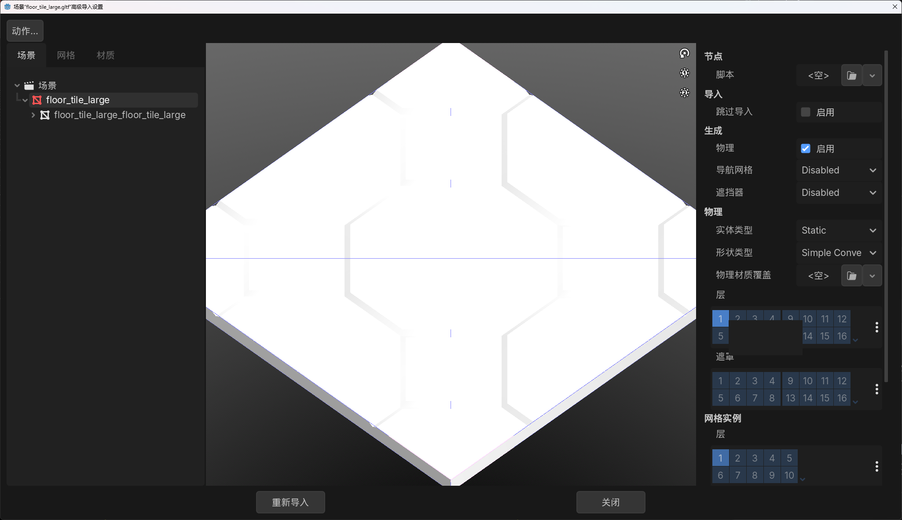
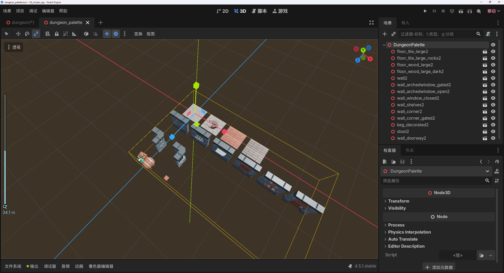
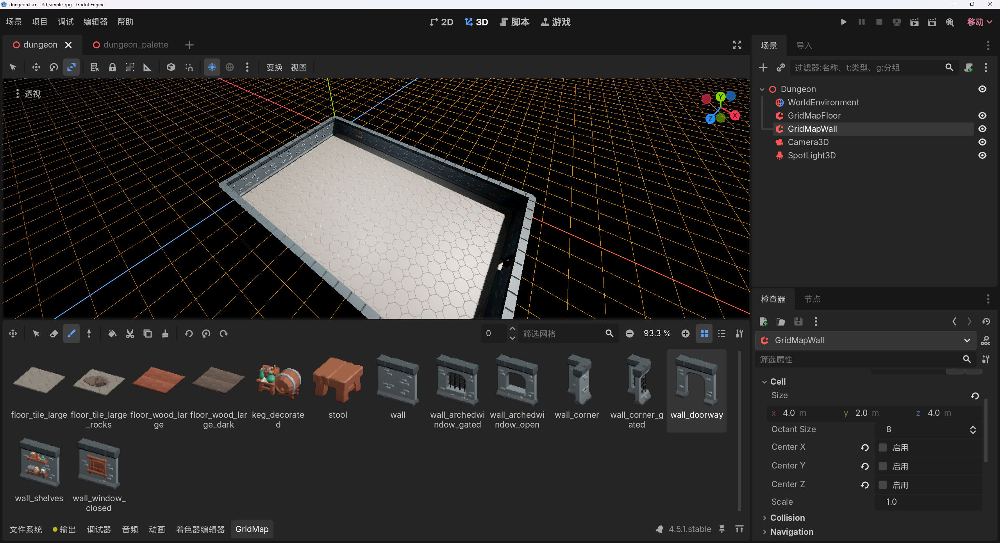
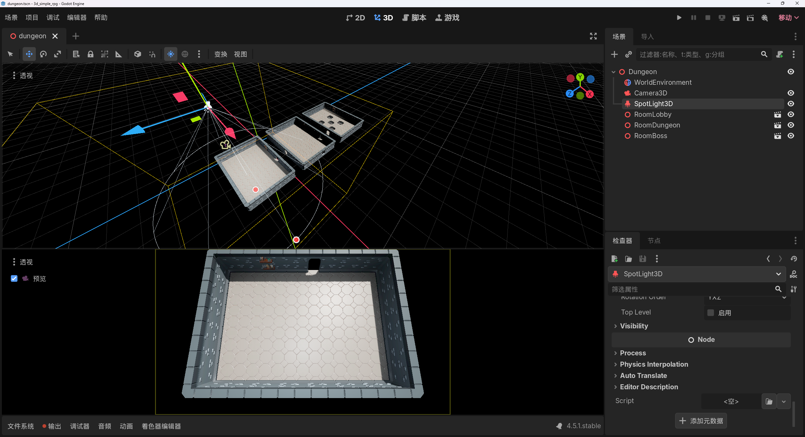
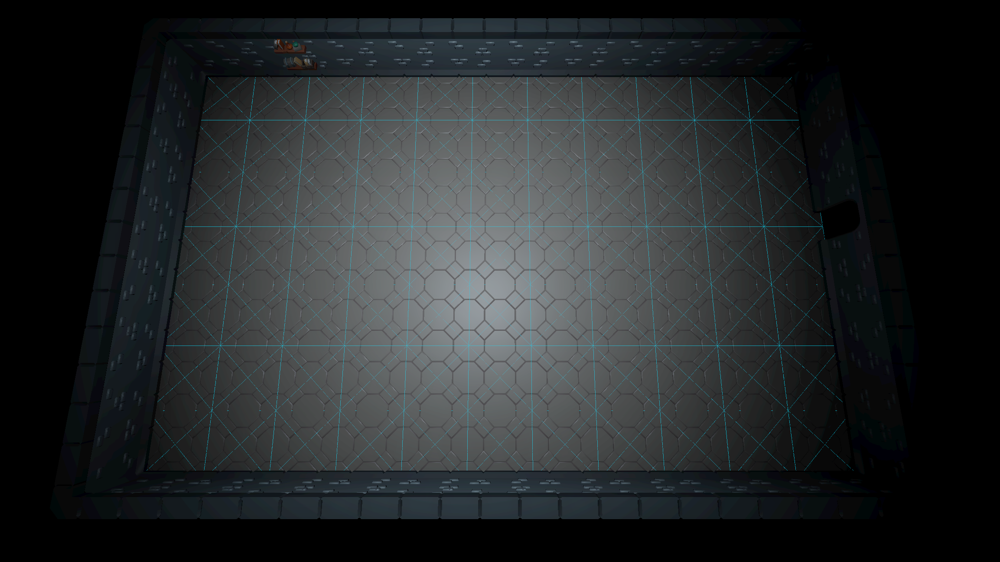
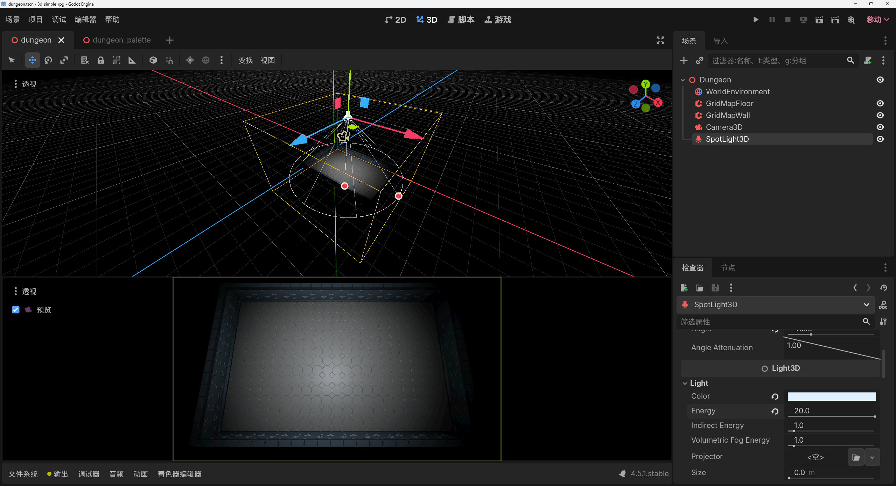

大家好，我是**玩物不丧志的老李**。

很多朋友想做独立游戏，尤其是那种经典复古的俯视角（Top-Down）地牢探险游戏。
在 Godot 游戏引擎 中，最适合的3D关卡搭建工具莫过于 **GridMap（网格地图）**。

但 GridMap 也是出了名的“坑多”。模型对不齐？材质改不了？碰撞不对劲？
今天这第一节课，我将带你走一遍**完整的 GridMap 配置流程**。
我们要避开所有坑，用 15 分钟搭建出一个包含大厅、地牢和BOSS房的完整关卡雏形。

## **本课目标：**

1. 掌握 Godot 4 的高级导入设置（自动生成碰撞与材质提取）。
2. 制作网格库并解决 GridMap 的“对齐”难题。
3. 搭建“大厅-地牢-BOSS”三房结构。
4. 配置透视摄像机与环境光效。

---

### 第一步：高级导入设置 —— 一劳永逸

我们要使用的是 [**KayKit Dungeon Remastered**](https://kaylousberg.itch.io/kaykit-dungeon-remastered) 素材包。在把它们拖进场景前，我们需要进行一次“深度加工”，确保它们自带碰撞且材质可编辑。

**1. 开启高级导入**

将模型文件拖入 `res://assets/models/` 后，**双击**你需要使用的模型文件（如 `floor.gltf`），或者选中文件后点击“导入”面板的“高级”按钮，弹出**高级导入设置**窗口。

**2. 自动生成物理碰撞 (Physics)**

我们不希望手动给几百块地板加碰撞体。

* 在左侧的场景树结构中，选中 **Mesh** 节点（网格节点）。
* 在右侧属性栏找到 **生成 (Generate)** -> **物理 (Physics)**，勾选 **启用 (On)**。
* **物理实体类型 (Body Type)**：保持默认的 **Static (静态)**。
* **形状类型 (Shape Type)**：修改为 **Simple Convex (简单凸包)**。Simple Convex 比 Trimesh 性能更好，比 Box 更贴合形状，非常适合地牢方块。
* **物理层 (Layer)**：保持默认的 Layer 1，我们可以去项目设置里把 Layer 1 重命名为“环境层 (Environment)”。

**3. 材质提取 (Material Extraction)**

为了方便以后统一修改地牢的色调（比如把地板变红），我们需要把材质提取出来。
* 关闭高级窗口，回到主界面的 **导入 (Import)** 面板。
* 找到 **材质 (Materials)** 分组。
* **位置 (Location)**：选择 **Extract and Overwrite (提取并覆盖)**。这表示我们将材质文件保存到外部，并让模型引用它。
* **路径 (Path)**：点击文件夹图标，选择 `res://assets/materials`（如果没有就新建一个）。
* 点击底部的 **重新导入 (Reimport)**。

---

### 第二步：制作网格库 (MeshLibrary)

GridMap 需要一个“调色板”，我们通过制作网格库来实现。网格库是一个资源文件，包含了所有地牢模块的网格数据。

1.  **创建源场景**：新建一个 3D 场景，根节点选择“Node3D”, 命名为 `library_source.tscn`。
2.  **排列素材**：

* 将处理好的地板、墙壁、门框、装饰物拖入场景。像摆货架一样把它们整齐排列，方便查看。
* **关于命名**：KayKit 的命名（如 `wall_corner.gltf`）已经非常清晰，我们可以直接使用。但如果你用的是杂乱的素材，建议重命名为 `wall_xxx`, `floor_xxx` 格式。

3.  **导出网格库**：
    * 点击顶部菜单 **场景 (Scene)** -> **导出为... (Export As...)** -> **网格库... (MeshLibrary...)**。
    * 保存路径：`res://assets/grid_library/dungeon_tileset.tres`。

---

### 第三步：GridMap 核心配置 —— 分层与对齐

这是本节课技术含量最高的地方，请仔细操作。

1.  新建主场景 `Main.tscn` (Node3D)。
2.  **GridMap 分层架构**：
    * 我们不把所有东西塞在一个节点里。创建两个 `GridMap` 节点，分别命名为：
        * `GridMap_Floor` (负责地面)
        * `GridMap_Walls` (负责墙体和高出地面的物体)

这样做的好处是，你可以随时隐藏墙壁层来观察内部，或者只重新绘制地板而不影响墙壁。

3.  **加载资源**：将两个节点的 `Mesh Library` 都设置为 `dungeon_tileset.tres`。
4.  **设置网格尺寸 (Cell Size)**：我们选择的素材是 4x4 大小的，所以将 **Cell -> Size** 设置为：**X: 4, Y: 2, Z: 4**。Y设为2是为了获得更细腻的高度控制。
5.  **解决对齐问题 (Center 设置)**：GridMap 默认会将模型放置在格子的正中心。但有些模型的原点设计在边缘，这会导致拼图时出现缝隙或错位。所以需要取消勾选 **Center X**、**Center Y**、**Center Z**。

---

### 第四步：绘制关卡 —— 三房结构

为了实现“摄像机平滑移动”的无缝体验，我们需要把所有房间都放在同一个世界里，但为了管理方便，我们不能把它们画在同一个 GridMap 节点上，而是应该把每个房间做成独立的场景，然后组装起来。

**1. 创建房间模板 (room_template.tscn)**

- 新建一个场景 `room_template.tscn`。根节点为 `Node3D`。
- 在下面添加我们配置好的 `GridMap_Floor` 和 `GridMap_Walls`（记得加载网格库并配置好 Cell Size 为 4,2,4）。
- 标准房间尺寸：为了获得紧凑的战斗体验，建议绘制 7 x 5 个网格单位 (即 28m x 20m)。

这就是我们的“毛坯房”，以后所有的房间都基于这个模板装修。

**2. 制作三个独立房间**

- 复制 `room_template.tscn` 场景，命名为 `room_lobby.tscn`。留出 北面 (上) 的出口缺口。
- 复制 `room_template.tscn` 场景，命名为 `room_dungeon.tscn`。留出 南面 (下) 的入口缺口。在房间内部画一些柱子或迷宫墙。
- 复制 `room_template.tscn` 场景，命名为 `room_boss.tscn`。同样大小，留出入口。地板可以换一种花纹（如果有的话）。

**3. 组装世界 (World Assembly)**

- 将这三个房间场景（.tscn）实例化到主场景中。
- 排列位置：`room_lobby` 放在原点 (0, 0, 0)。`room_dungeon` 放在北边远处，例如 (0, 0, -25)。(注意Godot中 -Z 是前方)`room_boss` 放在更远的地方，例如 (0, 0, -50)。

一定要留出足够的空隙，也就是“黑暗虚空”，这样摄像机在当前房间时，才不会拍到隔壁房间的边缘。

---

### 第五步：透视摄像机 —— 上帝视角

我们要实现类似现代 Top-Down 射击游戏或《挺进地牢》的视觉效果。

1.  添加 `Camera3D` 节点。
2.  **投影模式**：保持默认的 **Perspective (透视)**。透视投影能带来近大远小的纵深感，让墙壁的高度更明显。
3.  **关键参数设置**：**Position (位置)**：**(14, 18, 15)**。这个坐标能让摄像机正好对准一个标准房间（11x7网格）的中心位置。**Rotation (旋转)**：**X: -80** 度。接近垂直俯视，但保留了 10 度的倾角，能让我们看到墙壁的立面，而不是只看到墙顶。

---

### 第六步：环境与灯光 —— 氛围营造

最后，我们来为地牢打光。在这个环节，我们将抛弃平庸的全屏照亮，利用 SpotLight3D (聚光灯) 打造出一种类似“舞台追光”的高级质感。

**1. 纯黑背景**

首先，我们要切断外界的一切干扰。

- 在场景中添加 WorldEnvironment 节点。
- 新建 Environment 资源。
- Background Mode：选择 Custom Color (自定义颜色)。
- Color：设置为 纯黑 (#000000)。
- Ambient Light (环境光)：确保 Source 为 `Background`，或者能量设为 0。

现在，你的场景是一片死寂的黑暗，等待我们去点亮。现在，我们的三个房间（大厅、地牢、BOSS房）像孤岛一样悬浮在虚空中。我们要用光影给它们赋予不同的“情绪”。我们将采用 “房间独立照明” 的策略，而不是使用全局大灯。

**2. 点亮大厅 —— 温暖的避风港 (Room_Lobby)**

打开 `room_lobby.tscn` 场景。

- 添加一个 `SpotLight3D` 节点。
- 位置 (Transform)：放在房间中心的正上方，建议高度 Y: 10 (因为房间小了，灯不用太高)。
- Rotation：X: -90 度 (垂直向下)。
- 光照参数 (Light)：Color：暖橙色 (#FF9E45)。Energy：8 ~ 10 (根据高度调整)。Shadow：勾选 Enabled (这是立体感的关键)。
- 聚光参数 (Spot)：Range：20 (确保能照到地面)。Angle：60度 (调整角度，让光圈边缘刚好切在墙壁内侧，形成暗角)。

效果：大厅看起来像一个温暖的火炉旁，给人安全感。

**3. 点亮地牢 —— 阴冷的埋骨地 (Room_Dungeon)**

打开 `room_dungeon.tscn` 场景。

- 添加一个 `SpotLight3D` 节点。
- 位置 (Transform) ：Y: 10。同样居中，垂直向下。
- 光照参数 (Light)：Color：幽灵青 (#45FFCC) 或 冷蓝色 (#4590FF)。Energy：6 ~ 8 (比大厅暗一点，营造压抑感)。Shadow：勾选 Enabled。

效果：地牢看起来阴森恐怖，寒气逼人。

**4. 点亮BOSS房 —— 猩红的决斗场 (Room_Boss)**

打开 `room_boss.tscn` 场景。

- 添加一个 `SpotLight3D` 节点。
- 位置 (Transform)：Y: 10。同样居中，垂直向下。
- 光照参数 (Light)：Color：深红色 (#FF4545) 或 紫色。Energy：12 (更亮，更戏剧化)。Shadow：勾选 Enabled。

效果：充满危险和张力，预示着大战在即。

**5. 组合预览**

回到 `Main.tscn` 场景。 你会看到黑暗的虚空中，悬浮着三个颜色各异的“岛屿”。左边是暖橙色的大厅。远处是青蓝色的地牢。更远处是猩红色的BOSS房。

---

### 本课小结

恭喜！通过这一课，你已经掌握了 GridMap 最核心的“避坑指南”和配置技巧。我们搭建了一个结构清晰、视觉专业的 3D 地牢舞台。

**下节课预告：**
现在的地牢空无一人。下一节课，我们将导入**英雄角色**，实现 WASD 移动控制，并编写基础的**交互系统**——让这寂静的地下城热闹起来！

**这里是老李游戏学院，我们下节课见！**

---

[系列目录](../) · [下一课 →](../2/)
