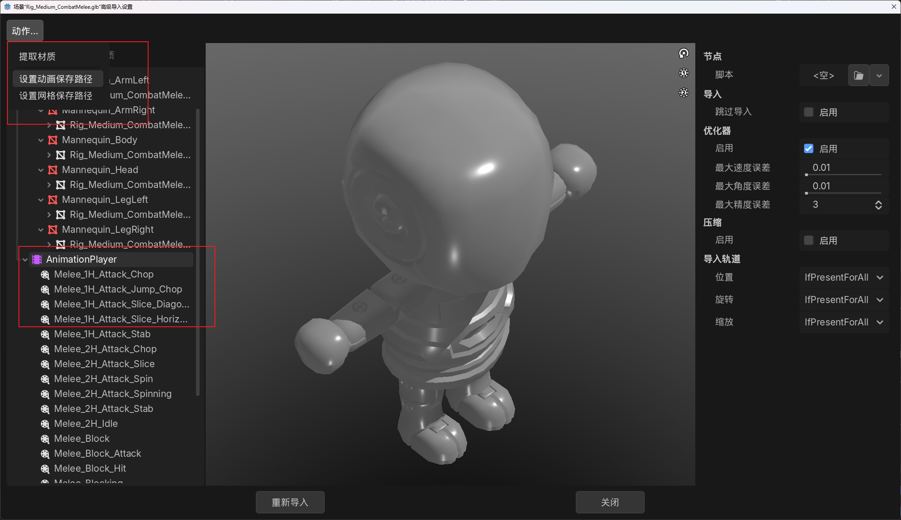
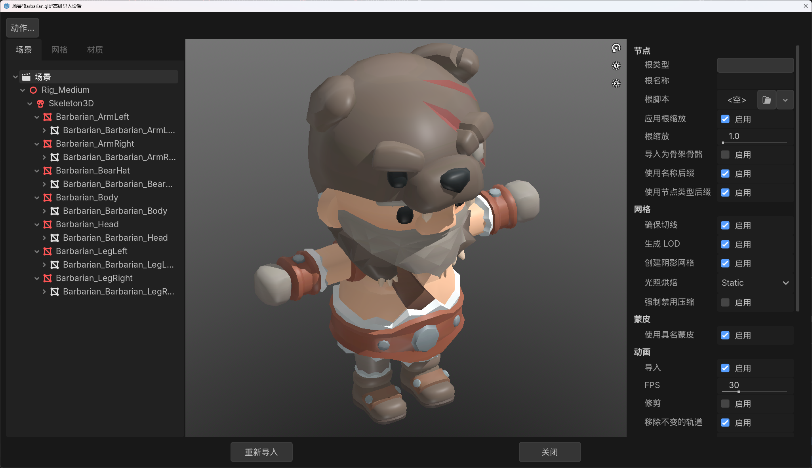
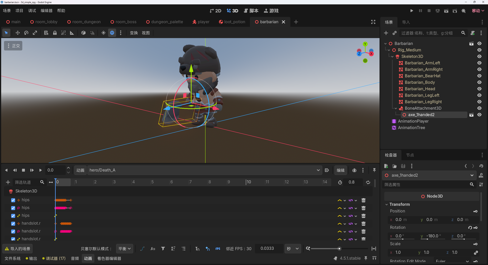
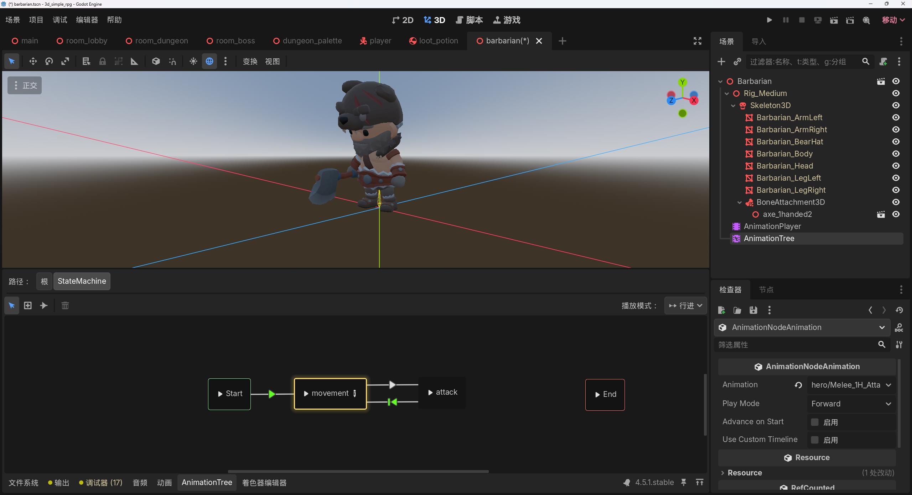
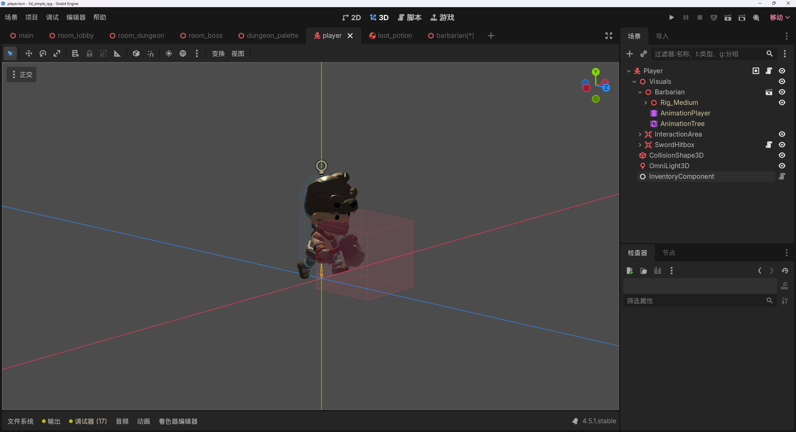
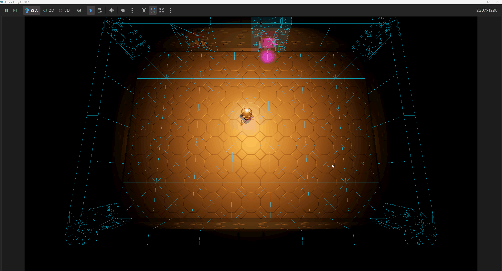

大家好，我是**玩物不丧志的老李**。

在上一节课，我们搭建了一个光影氛围极佳的地下城舞台。但现在，这个舞台是空的。
今天这节课，我们将邀请主角登场。

我们要实现的不只是简单的“能动就行”，而是要打造一种**商业级的手感**：

1.  **丝滑的加减速移动**（告别生硬的起步停车）。
2.  **平滑的转身动画**（告别瞬间掉头）。
3.  **自带随身光环**（探索黑暗虚空的必备神器）。
4.  **通用交互系统**（为后续的任务和对话打下地基）。

## **本课目标：**

1.  制作 `Player` 场景与物理配置。
2.  编写俯视角 3D 移动与动画脚本。
3.  实现“随身光源”方案。
4.  搭建基于 Area3D 的交互检测系统。

## 第一步：资产准备与动画提取

做 3D 游戏，第一步不是写代码，而是处理素材。KayKit 提供了非常棒的分离式素材，我们需要把模型和动画“组装”在一起。

### **1. 下载素材**

请访问以下链接下载资源（这也是对作者的支持）：

* **模型与武器**：[KayKit Adventurers](https://kaylousberg.itch.io/kaykit-adventurers) -> 下载 `KayKit_Adventurers_1.0_FREE.zip`
* **角色动画**：[KayKit Character Animations](https://kaylousberg.itch.io/kaykit-character-animations) -> 下载 `KayKit_Animations_1.0_FREE.zip`

解压后，将 `Barbarian.gltf`（在 Characters 文件夹）、`axe_1handed.gltf`（在 Assets 文件夹，包含bin文件）

动画导入`Rig_Medium_Combat_Melee.gltf`、`Rig_Medium_General.gltf`、`Rig_Medium_MovementBasic.gltf`。

### 2. 提取动画资源

Godot 4 允许我们把动画从 GLTF 文件中独立提取出来，保存为 `.res` 文件，这样可以复用给任何同骨骼的角色。

- **双击** `Animations.gltf` 打开高级导入设置。
- 在左侧列表中，选中 **AnimationPlayer** 节点。
- 在右侧面板，你会看到长长的动画列表。
- 在高级导入设置面板的左上角动作按钮，选择“设置动画保存路径”，选择`res://assets/animations/`。
- 此时会弹出“设置路径以重新导入时将动画另存为资源文件”面板，勾选后续会用到的动画（或者全部提取）。点击“设置路径”按钮，完成设置。
- 点击“重新导入”按钮，完成动画提取。



## 第二步：组装英雄

现在我们来把野蛮人、斧头和动画组装成一个完整的 `Player`。

### **1. 创建继承场景**



* 在文件系统中右键点击 `Barbarian.gltf` -> **新建继承场景 (New Inherited Scene)**。
* 将根节点重命名为 `PlayerVisuals`（或者直接把这个场景保存为 `Barbarian_Skin.tscn`，然后在 Player CharacterBody3D 下实例化它。为了教程简便，我们直接在这个继承场景上操作，稍后作为子节点加给 Player）。
* 建议：我们这里直接把这个继承场景保存为 `res://assets/scenes/characters/Barbarian_Skin.tscn`。

### **2. 武器挂载 (BoneAttachment3D)**

我们要把斧头拿在野蛮人手里，这就需要“骨骼挂点”。

* 在场景树中，选中 `Skeleton3D` 节点。
* 右键 -> **添加子节点** -> 搜索 **BoneAttachment3D**。
* 选中新加的 `BoneAttachment3D`，在右侧属性面板中：
    * **Bone Name**: 下拉选择 **handslot.r** (右手骨骼)。
    * 注意：此时视窗中该节点会自动吸附到右手位置。
* **添加武器**：
    * 将 `axe_1handed.gltf` 拖入，作为 `BoneAttachment3D` 的**子节点**。
* **调整位置**：
    * 斧头刚进去时位置可能不对（比如插在手心里）。
    * 选中 `axe_1handed.gltf` 节点，调整 `Transform` 的 Position 和 Rotation，直到斧柄完美地握在手里，且斧刃朝前。



**3. 配置 AnimationPlayer**

* 新增 `AnimationPlayer`。
* 在底部的动画编辑器中，点击 **动画 (Animation)** -> **管理动画库 (Manage Animations)**。
* 点击 **创建库 (Create Library)**，命名为`hero_animations`。
* 我们这里添加所有动画资源文件到这个库，方便后续复用。
* 对于idle、walk、run动画，设置为循环播放。
* **预览**：点击播放键，确保野蛮人能正确做动作，且斧头一直紧紧跟随着右手运动。

## 第三步：构建动画大脑 (AnimationTree)

光有动画还不够，我们需要一个逻辑大脑来平滑切换它们。

### **1. 添加 AnimationTree**

* 在场景根节点下添加 **AnimationTree** 节点。
* **Tree Root**: 选择 **AnimationNodeBlendTree** (动画混合树)。
* **Anim Player**: 指定为刚才配置好的 `AnimationPlayer`。
* **Active**: 勾选启用。

### **2. 编辑混合树 (Blend Tree)**

* 双击 `AnimationTree` 打开编辑器底部的图表界面。
* **添加状态机**：右键空白处 -> **添加节点 (Add Node)** -> **StateMachine**。将它连接到 `Output`。
* 现在我们的逻辑全部在这个 StateMachine 节点内部处理。

### **3. 配置状态机 (State Machine)**

* 点击图表中的 `StateMachine` 节点旁边的小铅笔图标（或双击它），进入状态机内部。
* **创建移动状态 (Movement)**：
    * 右键 -> **添加节点 (Add Node)** -> **BlendSpace1D**。
    * 重命名为 `Movement`。
    * 点击小铅笔图标进入 `Movement` 内部：
        * 将水平轴的范围设为 0 到 5 (0=静止, 1=跑动)。
        * 在 0 的位置添加点 -> **添加点 (Add Point)** -> 选择 `Idle` 动画。
        * 在 2 的位置添加点 -> **添加点 (Add Point)** -> 选择 `Walk` 动画。
        * 在 5 的位置添加点 -> **添加点 (Add Point)** -> 选择 `Run` 动画。
        * 效果：通过改变一个数值，就能实现从站立到奔跑的平滑过渡。

### **4. 设置切换逻辑 (Transitions)**

* 选中 `Movement -> Attack` 的连线：
    * **Advance -> Mode**: **Enabled** (允许代码触发) 。通常我们用代码控制 `travel("Attack")`。
    * **Switch Mode**: **Immediate** (立即切换)。
* 选中 `Attack -> Movement` 的连线 (自动回位)：
    * **Switch Mode**: **At End** (等待动画播放完毕)。
    * **Advance -> Mode**: **Auto** (自动触发)。
    * 这意味着攻击动画一播完，就会自动切回移动状态，无需写代码。



## 第一步：主角的诞生 (Scene Setup)

1. **新建场景**：创建一个新场景，根节点选择 **CharacterBody3D**，重命名为 `Player`。
2. **层级管理 (最佳实践)**：在 `Player` 下添加一个 `Node3D`，命名为 **Visuals**。我们将把模型放在这里面。
为什么要多这一层？因为我们希望逻辑（碰撞体）不旋转，而模型（Visuals）随着移动方向旋转。这样物理判定最稳定。
3. **导入模型**：将 `Barbarian_Skin.tscn` 拖入 `Visuals` 节点下。
4. **添加碰撞**：在 `Player` 根节点下添加 `CollisionShape3D`。形状选择 **CapsuleShape3D (胶囊体)**。调整位置：胶囊体默认在原点中心。将其 **Position Y** 上调 **1.0**（假设胶囊高2米），确保它的底部刚好对齐脚下的 Y=0 平面。
5.  **设置层级 (Layers)**：选中 `Player` 根节点。**Collision -> Layer**：设为 **2** (我们定义为 Player层)。**Collision -> Mask**：设为 **1** (Environment层)。这样主角就能稳稳地站在我们上一课画的地板上了。



## 第二步：随身光环 —— 照亮黑暗 (The Lantern)

还记得我们把环境光关掉造成了“虚空”效果吗？如果在房间之间的走廊没有灯，主角就会隐身。我们需要给主角挂一个灯笼。

1. 在 `Player` 根节点下，添加一个 **OmniLight3D (全向光)**。
2. **调整位置**：放在头顶上方一点，例如 **(0, 2.5, 0)**。
3. **参数设置**：
    * **Color**：**纯白** 或 **微黄 (#FFFDD0)**。
    * **Range (范围)**：**4.0**。不要太大，只要能照亮身边的路即可。
    * **Energy (能量)**：**0.8**。作为补光，不要抢了房间主灯的风头。
    * **Shadow (阴影)**：**取消勾选 (Disabled)**。
    为什么不开阴影？一是为了性能；二是因为主角脚底下的动态阴影在俯视角下有时会显得很乱，不开反而更干净。

## 第三步：输入映射 (Input Map)

在写代码前，告诉 Godot 哪个键是“上”、“下”、“左”、“右”、“交互”和“攻击”。

1. 点击顶部菜单 **项目** -> **项目设置** -> **输入映射**。
2. 添加以下动作并绑定按键：
    * `move_up`: **W**
    * `move_down`: **S**
    * `move_left`: **A**
    * `move_right`: **D**
    * `interact`: **E** (交互键)
    * `attack`: **J** 或 **鼠标左键** (为第四课做准备)

## 第四步：注入灵魂 —— 移动脚本

为 `Player` 根节点添加脚本 `player.gd`。
我们要实现的是带有**惯性**的移动，这比直接赋值速度要舒服得多。

```gdscript
extends CharacterBody3D

@export_group("Movement")
@export var speed: float = 5.0
@export var acceleration: float = 20.0 # 加速度：决定起步快慢
@export var rotation_speed: float = 12.0 # 转身速度

@onready var visuals: Node3D = $Visuals
@onready var animation_tree: AnimationTree = $Visuals/Barbarian/AnimationTree

var animation_state_machine: AnimationNodeStateMachinePlayback
var gravity = ProjectSettings.get_setting("physics/3d/default_gravity")

func _ready() -> void:
	animation_state_machine = animation_tree.get("parameters/StateMachine/playback")
	animation_state_machine.travel("movement")

func _physics_process(delta: float) -> void:
    if not is_on_floor():
        velocity.y -= gravity * delta

	# 1. 获取输入 (2D向量)
	var input_dir = Input.get_vector("move_left", "move_right", "move_up", "move_down")

	# 2. 转换为 3D 方向 (X/Z 平面)
	var direction = Vector3(input_dir.x, 0, input_dir.y).normalized()
	
	if direction:
		# 3. 移动逻辑：利用 move_toward 实现平滑加速
		velocity.x = move_toward(velocity.x, direction.x * speed, acceleration * delta)
		velocity.z = move_toward(velocity.z, direction.z * speed, acceleration * delta)
		
		# 4. 旋转逻辑：让 Visuals 平滑转向移动方向
		var target_angle = atan2(input_dir.x, input_dir.y)
		visuals.rotation.y = lerp_angle(visuals.rotation.y, target_angle, rotation_speed * delta)
	else:
		# 停止逻辑：利用 move_toward 实现平滑减速 (惯性停车)
		velocity.x = move_toward(velocity.x, 0, acceleration * delta)
		velocity.z = move_toward(velocity.z, 0, acceleration * delta)
		
	_set_movement_blend_position(velocity.length())
	# 6. 应用移动
	move_and_slide()

func _play_anim(anim_name: String) -> void:
	if not is_instance_valid(animation_state_machine):
		animation_state_machine = animation_tree.get("parameters/StateMachine/playback")
	if not is_instance_valid(animation_state_machine): return
	animation_state_machine.travel(anim_name)
	
func _set_movement_blend_position(blend_position: float) -> void:
	animation_tree.set("parameters/StateMachine/movement/blend_position", blend_position)
```

## 第五步：交互系统的雏形 (Interaction)

在 RPG 里，走到 NPC 面前按 E 说话是标配。我们在免费课里实现基础，在付费课里接入复杂的对话系统。

**1. 制作探测器 (InteractionArea)**

- 在 `Player` -> `Visuals` 节点下，添加一个 **Area3D**，命名为 `InteractionArea`。
- 注意：一定要放在 Visuals 下，这样它会随着主角旋转，始终检测主角正前方。
- 添加 `CollisionShape3D` (Box)，调整大小和位置，让它覆盖角色前方 1.5米左右的区域。
- **Layer 设置**：Layer 设为 None (0)，**Mask** 设为 **8** (我们预留给交互物体的层级)。

**2. 完善脚本 (player.gd)**

在 `player.gd` 中添加交互逻辑：

```gdscript
# ... 之前的代码 ...

@onready var interaction_area: Area3D = $Visuals/InteractionArea

func _unhandled_input(event: InputEvent) -> void:
    if event.is_action_pressed("interact"):
        _try_interact()

func _try_interact():
    # 获取探测区域内所有的物体
    var bodies = interaction_area.get_overlapping_areas() # 假设交互物也是Area3D
    if bodies.size() > 0:
        # 找到最近的一个 (简单处理：取第一个)
        var target = bodies[0]
        # 检查目标是否有 interact 方法
        if target.has_method("interact"):
            target.interact()
```

## 第六步：实战测试

1.  打开 `Main.tscn`。
2.  将 `Player.tscn` 拖入场景，放在大厅 (Room\_Lobby) 的地板上。
3.  运行游戏 (F5)。

**检查清单：**

* [ ] **移动**：按下 WASD，主角是否能平滑跑动？松开按键是否有惯性滑步？
* [ ] **动画**：跑步和待机动画是否切换自然？
* [ ] **光照**：试着把主角走到黑暗的虚空边缘，随身光源是否照亮了脚下的路？
* [ ] **碰撞**：试着撞墙，确认不会穿模。



-----

### 本课小结与痛点埋设

现在，你拥有了一个手感极佳的英雄。

但当你按下 **E** 键时，什么都不会发生，因为这个世界还是空的。

**下节课预告：**
下一节课，我们将制作**传送门**和**简单的 NPC**。
我们会实现“走到门口 -\> 黑屏转场 -\> 传送到地牢”的完整流程。同时，我们将尝试与 NPC 交互，虽然现在只能在控制台打印“Hello”，但这正是未来通向庞大剧情系统的第一步！

**这里是老李游戏学院，我们下节课见！**


---

[← 上一课](../1/) · [系列目录](../) · [下一课 →](../3/)
