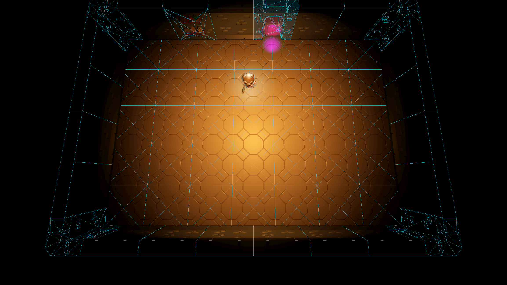
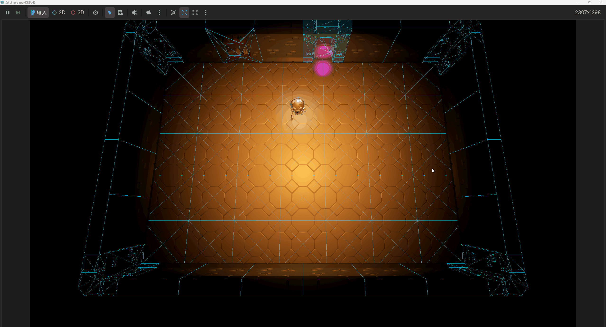

大家好，我是**玩物不丧志的老李**。

在上一节课，我们让英雄动了起来。今天，我们要连接大厅与地牢。
不同于生硬的“黑屏读条”，我们要实现一种类似《塞尔达传说》或《以撒的结合》的经典转场机制：**镜头平滑移动（Camera Sliding）**。

当玩家触发传送时，摄像机将优雅地划过黑暗的虚空，聚焦到新的房间。这种无缝的视觉流，能让你的游戏世界看起来像一个完整的整体。

## **本课目标：**

1. 封装 **`DungeonRoom`** 基类，定义摄像机锚点。
2. 制作 **`Teleporter`** (传送阵) 及其特效。
3. 编写 **主控制器逻辑**：实现摄像机的 Tween 平滑运镜。
4. 处理玩家的“消失与再现”。

## 第一步：定义房间的“最佳摄影位”

我们需要告诉系统，每个房间被“拍摄”时的标准姿势是什么。

### **1. 创建脚本 `dungeon_room.gd`**：

* 在文件系统创建脚本，代码如下：

```gdscript
class_name DungeonRoom extends Node3D

# 摄像机在这个房间应该停在这个位置
@export var camera_marker: Marker3D 
```

### 2. 配置房间

* 打开 `Room_Lobby.tscn`，挂载该脚本。
* 添加 **Marker3D** -> 命名为 `CamPos`。调整它，直到你在编辑器里通过“预览摄像机”看到的画面完美为止（参考第1课的参数：X:14, Y:14, Z:14, Rot:-75）。
* 在 Inspector 中赋值这两个变量。
* **同样操作**：配置 `Room_Dungeon.tscn`。

## 第二步：制作魔法传送阵

我们要制作一个看得见的、带有魔法效果的传送点。

1. **新建场景**：根节点 **Area3D**，命名为 `Teleporter`。
2. **添加碰撞**：在 `Teleporter` 下添加 `CollisionShape3D` (圆柱体)。形状选择 `CylinderShape3D` (圆柱体)，半径2.0，高度0.5，勾选 `Is Trigger`。在 Inspector -> `Collision` 分组中，将 **Layer (层)** 设为 None (0)，**Mask (遮罩)** 勾选我们为玩家交互预留的层（通常是 2）。

### **核心环节：GPUParticles3D 特效制作**

这部分是制作魔法阵的关键。

1.  **添加粒子节点**：在 `Teleporter` 节点下，添加一个 **GPUParticles3D** 节点。
2.  **基础显示设置 (Draw Passes)**：选中 `GPUParticles3D`。在 Inspector -> `Drawing` 分组中。**Draw Passes -> Pass 1**: 新建一个 `QuadMesh`。**Size (大小)**：`X: 0.1`, `Y: 0.1`。 (粒子大小，后续会在材质里调整)。
3.  **粒子行为设置 (Process Material)**：在 Inspector -> `Process Material` 槽中，新建一个 `ParticleProcessMaterial`。打开其详细设置。
    * **a. 发射器形状 (Emission Shape)**: `Emission Shape`：改为 **Ring (环形)**。`Ring Radius`：**1.0** (粒子从一个圆环边缘升起)。`Ring Inner Radius`：**0.8** (内环半径，让环形更明显)。
    * **b. 基本属性 (Lifetime & Speed)**: `Lifetime`：**2.0** (粒子存在时间)。`Speed Scale`：**0.5** (整体速度降低一半)。`Randomness`：**0.5** (增加粒子生命周期的随机性，看起来更自然)。
    * **c. 运动方向与重力 (Direction & Gravity)**: `Gravity`：`X: 0`, `Y: 1.0`, `Z: 0`。 (粒子向上飘)。`Initial Velocity`：`Velocity Min: 1.0`, `Velocity Max: 2.0`。 (给粒子一个初始向上的速度)。
    * **d. 旋转 (Rotation)** (可选，让粒子有自旋感): `Angle Min`：**-180**。`Angle Max`：**180**。`Angle Curve`：**新建 `Curve`**，让粒子在生命周期内缓慢加速旋转。
    * **e. 颜色与透明度 (Color & Alpha Curve)**: `Color`：设为你喜欢的魔法颜色，例如 **淡蓝色 (\#4590FF)** 或 **神秘的紫色 (\#FF00FF)**。`Color Ramp`：**新建 `Gradient`**。点击渐变条。添加 3 个关键点：**左侧 (0.0)**：颜色透明 (Alpha = 0)。**中间 (0.5)**：颜色完全不透明 (Alpha = 1)。**右侧 (1.0)**：颜色透明 (Alpha = 0)。*效果：粒子从透明出现，逐渐变亮，然后又逐渐消失，非常自然。*
    * **f. 大小 (Scale)**: `Scale Amount Min`：**0.5**。`Scale Amount Max`：**1.5**。`Scale Curve`：**新建 `Curve`**，让粒子从小变大，再变小。
    * **g. 碰撞 (Collision)** (关闭，我们不需要粒子与环境碰撞)。
3.  **调整发射器 (Emitting)**:选中 `GPUParticles3D` 节点。`Emitting`：**勾选 Enabled** (让粒子开始发射)。`Amount`：**50~100** (调整粒子数量，确保画面足够饱满)。`Explosiveness`：**0.0** (确保粒子平稳升起，而不是瞬间爆炸)。`Local Coords`: 勾选 (确保粒子相对传送阵移动)。
4.  **添加地标光柱 (The OmniLight3D)**:在 `Teleporter` 下添加一个 `OmniLight3D` 节点。**Color**：与粒子颜色一致。**Range**：**3.0**。**Energy**：**1.0 ~ 2.0**。**Shadow**：**取消勾选** (避免复杂的实时阴影)。*效果：让传送阵底部发出柔和的光芒，增强存在感。*



---

### **调试技巧**：

* **看不见粒子？** 确保 `GPUParticles3D` 的 `Drawing` -> `Draw Passes` 设置正确，`Process Material` 里 `Color Ramp` 没有全透明，以及 `Emitting` 勾选了。
* **粒子乱飞？** 检查 `Gravity` 和 `Initial Velocity`。
* **粒子太少？** 增加 `Amount`。
* **颜色不对？** 调整 `Color` 和 `Color Ramp`。

4. **编写脚本 `teleporter.gd`**：
    ```gdscript
    extends Area3D

    # 目标是哪个房间节点？直接拖拽赋值！
    @export var target_room: DungeonRoom
    @export var target : Node3D

    # 交互接口 (由 Player 脚本调用)
    func interact() -> void:
        print("传送开始...")
        if not target_room: return
        
        # 找到主场景，呼叫运镜系统
        var main = get_tree().current_scene
        if main.has_method("transition_to_room"):
            main.transition_to_room(target_room, target.global_position)
    ```
### 布置传送阵

1.  打开 `Main.tscn`。
2.  确保 `Room_Lobby` 在原点 `(0, 0, 0)`。
3.  将 `Room_Dungeon` 拖到远处，比如 `(0, 0, -25)`。
4.  在大厅门口放一个 `Teleporter`。在 Inspector 中，把场景树里的 `Room_Dungeon` 节点拖给 `Target Room` 属性。

## 第三步：房间切换逻辑

这是本课的高光时刻。我们要用 Godot 强大的 **Tween (补间动画)** 系统来实现丝滑运镜。

在 `Main` 节点上挂载 `main.gd`：

```gdscript
extends Node3D

@onready var player: CharacterBody3D = $RoomLobby/Player
@onready var camera: Camera3D = $Camera3D

# 运镜时间 (秒)
const TRANSITION_TIME = 1.5 

func _ready():
	# 初始化：游戏开始时，把摄像机瞬间定格在第一个房间
	var start_room = $RoomLobby
	camera.global_position = start_room.camera_marker.global_position

func transition_to_room(target_room: DungeonRoom, target_position: Vector3) -> void:
   # 1. 冻结玩家 (禁止乱动)
	player.set_physics_process(false)
	
	# 2. 视觉魔术：先隐藏玩家 (仿佛进入了传送通道)
	# 如果你有传送特效，应该在这里播放
	player.visible = false
	
	# 3. 创建运镜 Tween
	var tween = create_tween()
	# 设置缓动曲线：Cubic In/Out 会让起步和刹车非常平滑，很有电影感
	tween.set_trans(Tween.TRANS_CUBIC).set_ease(Tween.EASE_IN_OUT)
	
	# 4. 移动摄像机：从当前位置飞向目标房间的机位
	# 并行执行：同时改变位置
	tween.tween_property(camera, "global_position", target_room.camera_marker.global_position, TRANSITION_TIME)
	
	# 5. 等待运镜结束
	await tween.finished
	
	# 6. 搬运玩家
	player.reparent(target_room)
	player.global_position = target_position
	player.visible = true # 显示玩家
	
	# 7. 恢复控制
	player.set_physics_process(true)
```

-----

### 第五步：实战体验与视觉调整

运行游戏 (F5)。

1.  控制主角走到传送阵，按 **E**。
2.  **见证奇迹**：
      * 主角“嗖”地一下消失了。
      * 摄像机开始滑动，飞越中间黑暗的虚空。
      * 远处的地牢房间（散发着冷光）逐渐进入视野中心，最终完美定格。
      * 主角出现在地牢门口。
3.  **光影体验**：
      * 如果你按照第1课配置了房间独立灯光，你会看到画面从大厅的暖色，经过纯黑的过渡，滑入地牢的冷色。这种**冷暖交替的视觉流动**，简直太棒了！



-----

### 本课小结

恭喜！你实现了一个极具**独立游戏美学**的转场系统。这比生硬的黑屏切换要高级得多，因为它保持了游戏世界的连续性。

现在的传送是瞬间完成的。大家有没有觉得，主角突然消失再突然出现，稍微有点‘干’？

在真正的商业游戏里，我们会加入**剧情演出 (Cutscene)**：比如传送前播放一个‘施法动画’，传送后播放一个‘落地缓冲动画’。甚至，如果这是一个 BOSS 房，摄像机滑过去后，不应该立刻把控制权还给玩家，而是应该**自动对准 BOSS，播放一段出场吼叫**。如何接管玩家控制权？如何编排这一连串的演出？这就是我们在**进阶架构课**里要讲的重头戏 —— **剧情演出系统**。

## 下节课预告
有了这么帅的转场，地牢里却空空如也？下一节课，**第04课：杀戮的代价**，我们将放入骷髅卫兵，实现爽快的**战斗与物理掉落**！

**这里是老李游戏学院，我们下节课见！**


---

[← 上一课](../2/) · [系列目录](../) · [下一课 →](../4/)
