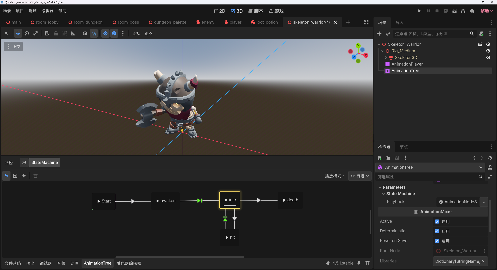
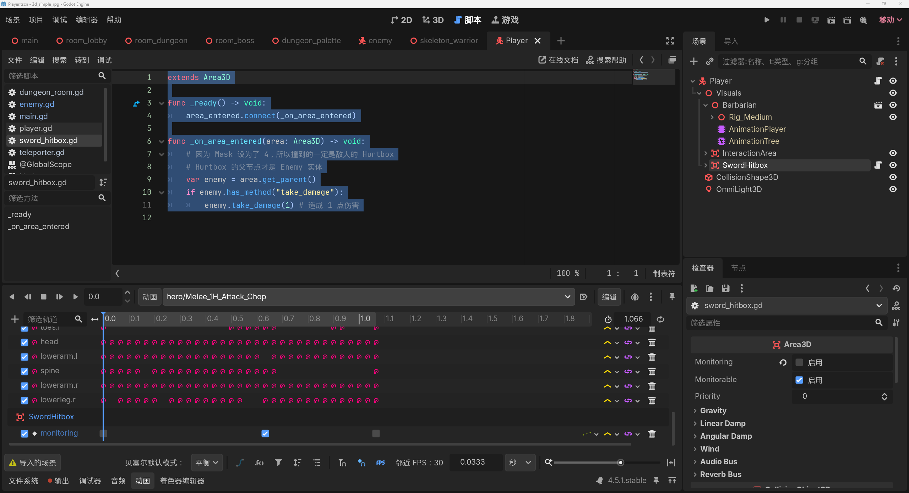
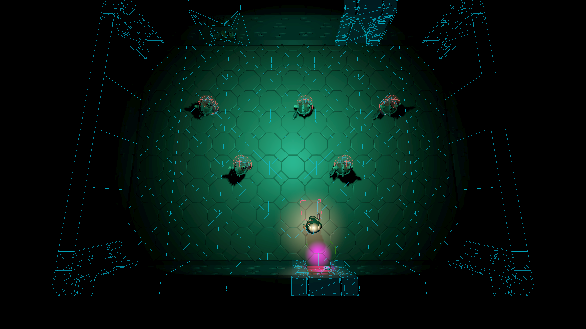

大家好，我是**玩物不丧志的老李**。

在上一节课，我们打通了大厅与地牢的连接。但现在的地牢空空如也，毫无挑战。今天，我们将唤醒沉睡的亡灵。我们要实现：

1. **精准的攻击判定**（利用动画驱动 Hitbox）。
2. **爽快的物理掉落**（让战利品像喷泉一样爆出来）。
3. **简单的游戏闭环**（杀怪 -\> 开门）。

## **本课目标：**

1.  制作 `Enemy_Skeleton` 敌人场景，分离碰撞盒(Body)与受击盒(Hurtbox)。
2.  制作 `Sword_Hitbox`，利用 AnimationPlayer 实现攻击判定。
3.  制作 `Loot_Item` (刚体掉落物)，实现物理抛射效果。

## 第一步：唤醒亡灵

我们需要一个能够挨打的木桩。

骷髅的模型在[KayKit Skeletons](https://kaylousberg.itch.io/kaykit-skeletons)中可以找到。这里我们选择导入`skeleton_warrior.gltf`。武器导入`skeleton_axe.gltf`。值得注意的是之前的动画文件我们需要补充导入`Rid_Medium_Special`动画文件。其中包含适配骷髅怪物的各种动作。

模型的导入设置以及前期准备与player角色一致，这里不再赘述。
值得一提的是动画状态机设置，这里我们添加`SkeletonsAwakenFloor`\`SkelectonsIdle`和`SkeletonsDeath`动画状态，并依次相连。




1. 新建场景，根节点 **CharacterBody3D**，命名为 `Enemy_Skeleton`。导入 KayKit 的骷髅模型 (`skeleton.gltf`)。
2. 设置物理碰撞**：
    * 添加 `CollisionShape3D` (Capsule)，包裹住骷髅。
    * **Layer**: 设为 **4** (我们定义为 Enemy 层)。这个碰撞体是为了防止玩家穿过怪物，也是为了物理推挤。
3.  关键架构：受击盒 (Hurtbox)
      * 在根节点下添加一个 **Area3D**，命名为 `Hurtbox`。
    * 在 `Hurtbox` 下添加一个新的 `CollisionShape3D` (Box)，比模型稍微大一圈。
    * **Layer 设置**：**Layer**: **4** (Enemy 层)。**Mask**: **0** (受击盒不需要去撞别人，只需要等着被撞)。
4.  编写脚本 `enemy.gd`：

```gdscript
extends CharacterBody3D

@onready var animation_tree: AnimationTree = $Skeleton_Warrior/AnimationTree

# 预留给掉落物的插槽 (稍后制作)
@export var loot_scene: PackedScene 

# 简单的生命值
var hp: int = 3
var animation_state_machine : AnimationNodeStateMachinePlayback

func _ready() -> void:
	animation_state_machine = animation_tree.get("parameters/StateMachine/playback")
	hide()

func awaken() -> void:
    # 【可选的高级技巧】
    # 为了防止所有骷髅像机器人一样整齐划一地苏醒
    # 我们可以加一个极短的随机延迟，让它们错落有致
    # await get_tree().create_timer(randf_range(0.1, 0.5)).timeout	
    show()
	animation_state_machine.travel("awaken")

# 公开接口：受到伤害
func take_damage(amount: int) -> void:
	hp -= amount
	print("骷髅受到伤害！剩余HP: ", hp)
	
	# 受击反馈 (简单的闪白或动画，这里省略)
	
	if hp <= 0:
		die()

func die() -> void:
	# 1. 生成掉落物 (稍后实现)
	spawn_loot()
	# 2. 销毁自身
	queue_free()

func spawn_loot() -> void:
	# 占位
	pass
```

## 第二步：配置房间脚本 (DungeonRoom.gd)

我们在之前的课程中设计了 DungeonRoom 基类，并在第3课实现了转场。现在我们要利用房间生命周期来唤醒怪物。

场景设置建议： 在你的 Room_Dungeon.tscn 场景中，建议创建一个 Node3D 节点命名为 Enemies，把所有骷髅都放在这个节点下面。这样管理起来非常方便。

```text
- Room_Dungeon (Node3D)
  - Geometry
  - Enemies (Node3D) <--- 把骷髅都放这里
    - Skeleton1
    - Skeleton2
```

修改房间代码：打开 `dungeon_room.gd`（或者具体的子类脚本），完善 `on_player_enter` 方法：

```gdscript

class_name DungeonRoom extends Node3D

# ... (之前的 Marker3D 变量) ...

# 引用存放怪物的父节点
# 在编辑器里把那个 "Enemies" 节点拖进来赋值
@export var enemies_container: Node3D 

# --- 房间生命周期 ---
# 这个函数由 Main.gd (LevelManager) 在传送结束、屏幕亮起前调用
func on_player_enter():
	print("玩家进入房间：", name)
	
	# 唤醒所有怪物
	if enemies_container:
		_awaken_all_enemies()

func _awaken_all_enemies():
	# 遍历 Enemies 节点下的所有孩子
	for enemy in enemies_container.get_children():
		# 检查孩子是否有 awaken 方法 (防止你把非怪物的节点放进去了)
		if enemy.has_method("awaken"):
			enemy.awaken()
```

## 第三步：神剑出鞘 (The Hitbox)

主角需要一把能造成伤害的剑。我们不使用物理碰撞来攻击，而是使用更精准的 **Area3D 触发器**。

1.  **打开 `Player` 场景**。

2.  **添加 Hitbox**：

      * 在 `Visuals` 节点下（确保跟随旋转），添加 **Area3D**，命名为 `SwordHitbox`。
      * 添加 `CollisionShape3D` (Box)，调整位置覆盖角色前方攻击范围。
      * **Layer 设置**：
          * **Layer**: **0** (不属于任何物理层)。
          * **Mask**: **4** (专门检测 Enemy 层)。
      * **关键设置**：在 Inspector 中，将 **Monitoring** (监测) 默认为 **False (关闭)**。

平时剑是“钝”的，只有挥舞的那一瞬间才是“利”的。

3.  **动画驱动逻辑 (Animation Tracks)**：
      * 打开 `AnimationPlayer`，找到 `Attack` 动画。
      * 点击 **添加轨道 (Add Track)** -\> **Property Track (属性轨道)** -\> 选择 `SwordHitbox` -\> 选择 `monitoring`。
      * **打关键帧**：
          * **0.0s**: `False` (起手)。
          * **0.2s** (挥剑瞬间): `True` (开启伤害检测)。
          * **0.4s** (收招): `False` (关闭检测)。

这就是动作游戏的精髓：判定由动画帧决定，精准且符合直觉。

4. 给 `SwordHitbox` 节点添加脚本：

```gdscript
extends Area3D

func _ready() -> void:
	area_entered.connect(_on_area_entered)

func _on_area_entered(area: Area3D) -> void:
	# 因为 Mask 设为了 4，所以撞到的一定是敌人的 Hurtbox
	# Hurtbox 的父节点才是 Enemy 实体
	var enemy = area.get_parent()
	if enemy.has_method("take_damage"):
		enemy.take_damage(1) # 造成 1 点伤害
```



## 第四步：物理掉落与拾取

现在我们来做那个让玩家上瘾的“爆装备”环节。

### 1. 制作掉落物场景

* 新建场景，根节点 **RigidBody3D** (刚体)，命名为 `Loot_Potion`。
* 为什么用刚体？因为我们要把它像垃圾一样抛出去，让它在地上弹跳！
* 导入药水模型。
* 添加 `CollisionShape3D` (Sphere)。
* **Layer mask设置**：设为 **Environment** (1) 层，确保它能掉在地上，不会穿过地板。
* **Lock Rotation**：建议勾选，防止药水瓶在地上滚个不停。

### 2. 添加拾取检测

* 在根节点下添加 **Area3D**。范围比刚体稍大, 命名为`LootArea`。
* 添加脚本 `loot_item.gd`：
* 设置**Layer mask**：**0** (不属于任何物理层)。**Mask**: **2** (专门检测 Player 层)。

```gdscript
extends RigidBody3D

@onready var loot_area: Area3D = $LootArea

func _ready() -> void:
	loot_area.body_entered.connect(_on_body_entered)

func collect() -> void:
	print(">>> 捡到了 [红药水]！")
	print(">>> 系统提示：由于背包系统尚未开发，物品已消失在虚空中...")
	
	# 播放音效 (可选)
	# Audio.play("pop")
	
	queue_free()

func _on_body_entered(body) -> void:
	if body.is_in_group("Player"):
		collect()
```

3.  完善怪物掉落逻辑：

回到 `enemy.gd`，完善 `spawn_loot()`：

```gdscript
func spawn_loot() -> void:
    if loot_scene:
        var loot = loot_scene.instantiate()
        # 添加到当前场景 (不要加给怪物自己，因为怪物要死)
        get_parent().add_child(loot)
        loot.global_position = global_position + Vector3(0, 1, 0)
        
        # 给它一个随机的爆炸推力！(Juice)
        var random_dir = Vector3(randf_range(-1, 1), 2, randf_range(-1, 1)).normalized()
        loot.apply_impulse(random_dir * 5.0)
```

4.  **配置**：
      * 将 `Loot_Potion.tscn` 拖给 `Enemy_Skeleton` 场景脚本里的 `Loot Scene` 变量。

-----

## 第五步：实战演练与闭环

1. 在 `Room_Dungeon` 场景里放置 3-5 个骷髅。
2. 运行游戏：从大厅传送进地牢。拔剑砍杀！看着骷髅碎裂，药水瓶“嘭”地一声爆出来，在地上弹跳。跑过去捡起来。控制台打印：“物品已消失...”。



-----

## 本课小结

恭喜！你完成了一个可玩的地牢 RPG Demo！
你能跑、能砍、能捡东西、能过图。

**但是... 现在的游戏体验完整吗？**

1. 背包去哪了？你捡了一地的药水，界面上却没有任何显示，也不知道自己有多少血瓶。
2. 任务在哪？你杀光了骷髅，成了英雄，但村长不知道，也没有人给你发奖励。

这就是“Demo”和“商业游戏”的区别。

在我们的《Godot 游戏框架设计与实现：对话与任务篇》进阶课程中，我们将解决这些所有问题：

* 我们将构建 **数据驱动的任务系统**，自动记录你的击杀。
* 我们将构建 **可视化的背包系统**，让你看到每一个战利品。
* 我们将构建 **剧情演出系统**，让 BOSS 登场充满压迫感。


---

[← 上一课](../3/) · [系列目录](../) · [下一课 →](../5/)
