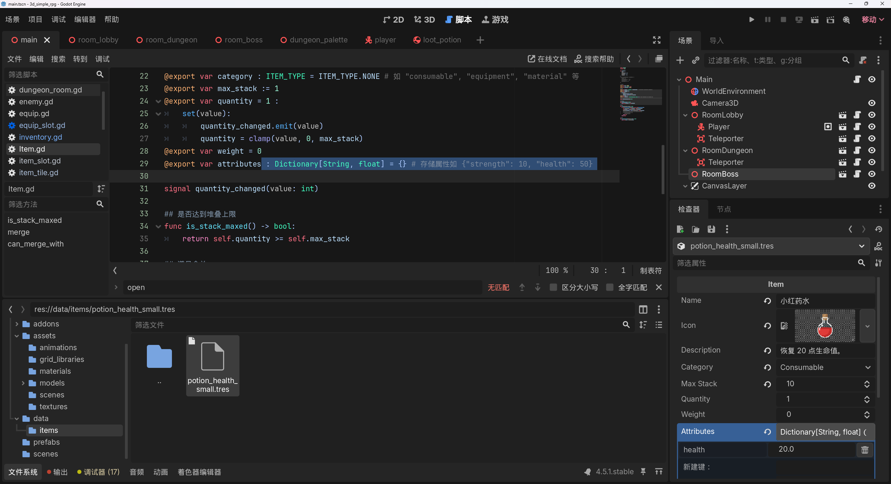

大家好，我是**玩物不丧志的老李**。

在上一节课中，我们在地牢里捡起了一瓶红药水，但控制台却无情地告诉我们：“物品已消失在虚空中”。
为什么？因为我们没有**背包系统**。

如果要从零开始写一个完善的背包（包含堆叠、分类、装备栏、拖拽），可能需要好几节课的时间。但在商业开发中，我们通常不会重复造轮子。

今天，我们将把一套我已经封装好的背包插件 [**GodotSimpleInventory**](https://gitee.com/Giab/godot-simple-inventory) 直接接入到我们的地牢项目中。

只需 10 分钟，你的游戏将拥有完整的物品管理能力！

## **本课目标：**

1. 安装并启用 **GodotSimpleInventory** 背包插件。
2. 配置 **Item** 资源数据（药水、武器）。
3. 实装 **UI** 并打通“拾取 -> 进包”的逻辑闭环。

## 第一步：插件安装

1. 将插件文件夹 `res://addons/simple_inventory/` 复制到你的项目`addons`目录下。
2. 在插件管理器中启用 **GodotSimpleInventory** 插件。

## 第二步：配置数据 —— 定义你的战利品

插件是通用的，但“红药水”是这个游戏特有的。我们需要利用插件提供的 `Item` 类来定义它。

1. **创建资源文件夹**：在 `res://data/` 下新建文件夹 `items`。

### 2. **创建红药水**

* 右键 -> **新建资源 (New Resource)**。
* 搜索 **Item** (这是插件提供的自定义类)。
* 命名为 `potion_health_small.tres`。

### 3.  **填写属性**：

* **Name**: 小红药水
* **Description**: 恢复 20 点生命值。
* **Category**: `CONSUMABLE` (消耗品)。
* **Max Stack**: 10 (允许堆叠 10 个)。
* **Icon**: 拖入之前的药水贴图。
* **Attributes**: 点击添加键值对，例如 `health: 20`。

图标就用svg格式，自己画一个。

```xml
<svg width="64" height="64" viewBox="0 0 64 64" fill="none" xmlns="http://www.w3.org/2000/svg">
  <rect x="26" y="4" width="12" height="10" rx="2" fill="#A0522D"/>
  
  <path d="M26 14H38V24.5C45.5 26.5 52 33 52 42C52 53.0457 43.0457 62 32 62C20.9543 62 12 53.0457 12 42C12 33 18.5 26.5 26 24.5V14Z" fill="#FF5555"/>
  
  <path d="M12 42C12 53.0457 20.9543 62 32 62C43.0457 62 52 53.0457 52 42C52 38 50 35 48 34C40 40 24 40 16 34C13 36 12 39 12 42Z" fill="#D32F2F" fill-opacity="0.3"/>

  <path d="M20 32Q18 36 18 42" stroke="white" stroke-width="3" stroke-linecap="round" opacity="0.6"/>
  <circle cx="44" cy="30" r="3" fill="white" opacity="0.5"/>

  <path d="M26 14H38V24.5C45.5 26.5 52 33 52 42C52 53.0457 43.0457 62 32 62C20.9543 62 12 53.0457 12 42C12 33 18.5 26.5 26 24.5V14Z" stroke="#2C3E50" stroke-width="4" stroke-linejoin="round"/>
  
  <path d="M26 14V4H38V14" stroke="#2C3E50" stroke-width="4" stroke-linejoin="round"/>
  
  <path d="M24 14H40" stroke="#2C3E50" stroke-width="4" stroke-linecap="round"/>
</svg>
```



## 第三步：组装主角 —— 挂载背包组件

既然是“老李通用背包插件”，它的核心理念就是即插即用。我们要给主角“插”上一个背包。

1. 打开主角场景：打开 Player.tscn。
2. 添加组件：在 Player 根节点下，搜索并添加 C_Inventory 节点（这是插件提供的核心类）。重命名为InventoryComponent。
3. 在编辑器中配置：
    * 选中 InventoryComponent。
    * 在右侧 Inspector 中，你可以直接看到插件暴露的参数。
    * Equip Slots: 这里已经预设了装备槽（头、胸、腿等），你可以在这里增删改。
    * Max Slot Count: 比如设为 20。
这就是组件化的好处，不用写代码，直接在属性面板里配置你的背包容量。

4. 初始化测试数据 (可选)：在 Player.gd 的 _ready 函数里，给刚出生的主角塞点东西。

```gdscript
# Player.gd
extends CharacterBody3D

@onready var inventory_comp = $InventoryComponent

func _ready():
    # ... 之前的初始化 ...
    
    # 【测试福利】送 3 瓶药水
    var potion = load("res://data/items/potion_health_small.tres")
    if potion:
        for i in range(3):
            inventory_comp.add_item(potion.duplicate())

func get_inventory() -> C_Inventory:
	return inventory_component
```

现在，只要游戏启动，玩家就在逻辑上拥有了一个背包，并且里面已经装了3瓶药水。

-----

## 第四步：UI 连接 —— 谁的背包？

现在 UI 需要知道它显示的是谁的背包。我们找 Player。

1. 打开 `Main.tscn`。
2. 创建 `CanvasLayer` (UI层)，添加子节点Control，命名为“HUD”。
3. 在`HUD`节点下，实例化场景：`res://addons/simple_inventory/src/widgets/inventory.tscn`，将其命名为`Inventory`

```gdscript
# Main.gd
extends Node3D

@onready var player = $Player
@onready var inventory_ui = $HUD/Inventory

func _ready() -> void:
    # ... 之前的代码 ...
    
    # 【核心修改】依赖注入
    # 我们获取 Player 身上的组件，传给 UI
    var player_inventory = player.get_inventory() # 确保你在player脚本中实现了这个方法
    inventory_ui.initialize(player_inventory)

func _unhandled_input(event):
    if event.is_action_pressed("toggle_inventory"):
        if inventory_ui.visible:
            inventory_ui.hide()
        else:
            inventory_ui.open()
```

**注意**：记得去 `Project Settings -> Input Map` 添加 `toggle_inventory` 绑定到 `B` 或 `I` 键。

-----

## 第五步：打通闭环 —— 拾取物品

最后一步，我们要修改第 04 课留下的 `LootItem` 脚本，让地上的东西真的进包。

1.  **修改掉落物场景**：

* 打开 `Loot_Potion.tscn`。
* 在根节点脚本 `loot_item.gd` 中，增加一个导出变量，用于指定这个掉落物对应哪个数据。

```gdscript
extends RigidBody3D

@onready var loot_area: Area3D = $LootArea

@export var item_def: Item 

func _ready() -> void:
	loot_area.body_entered.connect(_on_body_entered)

func collect(target_inventory: C_Inventory) -> void:
	if is_instance_valid(item_def):
		print("物品进入背包：", item_def.name)
		# 调用组件的方法添加物品
		target_inventory.add_item(item_def.duplicate())
		
		# 播放音效...
		queue_free()
	else:
		printerr("错误：掉落物未配置 Item 数据")

func _on_body_entered(body) -> void:
    # 组件化开发
	# 我们不管撞到的是 Player 还是 NPC，只要它身上有 InventoryComponent，就能捡！
	var inventory = body.get_inventory()
	
	if is_instance_valid(inventory):
		collect(inventory)
```

2.  **配置掉落物**：

* 在 `Loot_Potion.tscn` 的 Inspector 中，将之前创建的 `potion_health_small.tres` 拖入 **Item Def** 属性。

-----

### 第六步：见证奇迹

运行游戏 (F5)。

1.  **开局**：按 **B** 键打开背包，你会看到已经有了 3 瓶药水（这是我们在 `_ready` 里送的）。
2.  **战斗**：去地牢砍死骷髅。
3.  **掉落**：骷髅爆出一个药水瓶（刚体物理效果）。
4.  **拾取**：走过去，药水瓶消失。
5.  **验证**：再次按 **B** 键。看！背包里的药水数量增加了！而且它们自动堆叠在了一起！
6.  **整理**：点击“整理”按钮，看着混乱的格子瞬间变得井井有条。

-----

### 本课小结

这就是**插件化开发**的力量。
我们没有写一行关于“数组操作”、“格子绘制”、“堆叠算法”的代码，仅仅通过**配置**和**调用接口**，就为游戏加入了一个背包系统。

**老李的插件 GodotGear** 帮我们解决了所有底层脏活累活，让我们能专注于游戏设计。

在接下来的课程中，我们将继续完善这个系统，利用背包里的 **Key (钥匙)** 去打开地牢深处的 **Gate (大门)**。

**这里是老李游戏学院，我们下节课见！**


---

[← 上一课](../4/) · [系列目录](../)
